# バトル画面の状態遷移

ルールは [バトルのルール](../../01_requirements/battle/01_バトルのルール.md)。ここでは、画面が取る状態、ミスの数え方の細部、状態ごとの表示の出し分けを決める。実装は `battle-reducer.ts`（状態遷移）・`judge.ts`（1文字ごとの判定）・`scoring.ts`（ダメージ・評価）。



> 図のソースは [`01_バトル画面の状態遷移.01.mmd`](./01_バトル画面の状態遷移.01.mmd)（mermaid）。編集後は次で再生成する（プロジェクトのルートフォルダで実行。要 Docker Desktop 起動）:
>
> ```powershell
> docker run --rm -v ${PWD}:/data minlag/mermaid-cli:11.12.0 -i docs/specs/02_basic-design/battle/01_バトル画面の状態遷移.01.mmd -o docs/specs/02_basic-design/battle/01_バトル画面の状態遷移.01.svg
> ```

## バトルが持つ状態

| 項目 | 初期値 | 内容 |
| --- | --- | --- |
| `phase` | 入力待ち | 上の図の状態（入力待ち・ダメージ表示・とどめの一撃） |
| `boss` | 開始時に選んだボス | [ボスの選び方](../boss-zukan/01_ボスデータと選び方.md#ボスの選び方) |
| `words` | 開始時に選んだ5語 | お題。この順に出す（[お題の選び方](05_お題の選び方.md)） |
| `slot` | 0 | 何問目か（0〜4）。0〜2が通常問題、3〜4がとどめ問題。今のお題は `words[slot]` |
| `hp` | 500 | ボスの残りHP |
| `typedCount` | 0 | 今のお題を、先頭から何文字目まで正しく打てたか |
| `wrongText` | 空 | 入力欄に残っている、お題と違う部分。空なら「合っている」 |
| `needsJapaneseInput` | `false` | 日本語入力がオフのまま打っていると見なしたか（[ミスの数え方](#ミスの数え方)） |
| `missCount` | 0 | ミスの回数（1バトルの通算。問題が変わっても引き継ぐ） |
| `lastDamage` | 0 | 直前に与えたダメージ。ダメージの表示に使う |

- お題は端末にあり、待ち時間が無い。`/battle` を開いた時点でボスと5語を選び、すぐ入力待ちになる。
- 怒りモードかどうか（`missCount` が 5 以上）は、`missCount` から決める。

## 状態の遷移

「入力欄の中身が変わった」とは、打った・消した・変換の候補を選んだなどで、入力欄の文字列が変わったことを指す。そのたびに、入力欄の中身の全体を今のお題と比べる。

| 今の状態 | きっかけ | 更新する値 | 次の状態 |
| --- | --- | --- | --- |
| （開始） | `/battle` を開く | ボスと5語を選び、保存する（[保存のタイミング](../local-storage/01_保存データの形.md#保存のタイミング)） | 入力待ち |
| 入力待ち | 入力欄の中身が変わり、合っている（まだ途中） | `typedCount` を更新、`wrongText` を空に、`needsJapaneseInput` = `false` | 入力待ち |
| 入力待ち | 入力欄の中身が変わり、違っている（直前は合っていた） | `missCount` +1、`typedCount`・`wrongText`・`needsJapaneseInput` を更新 | 入力待ち |
| 入力待ち | 入力欄の中身が変わり、違っている（直前も違っていた） | `typedCount`・`wrongText`・`needsJapaneseInput` を更新（`missCount` は変えない） | 入力待ち |
| 入力待ち（1〜3問目） | お題の最後の文字まで打てた | `hp` −100、`lastDamage` = 100 | ダメージ表示 |
| 入力待ち（4問目） | お題の最後の文字まで打てた | `hp` −（`hp` の半分）、`lastDamage` = 減らした量 | ダメージ表示 |
| 入力待ち（5問目） | お題の最後の文字まで打てた | `lastDamage` = 減らす前の `hp`、`hp` = 0 | とどめの一撃 |
| ダメージ表示 | 約1秒経過 | `slot` +1、`typedCount` = 0、入力欄を空にする | 入力待ち |
| とどめの一撃 | 約2秒経過 | 結果を作る（[結果画面の表示](02_結果画面の表示.md#結果の作り方)） | 結果画面へ |

- 失敗が無いので、`hp` は必ず 500 → 400 → 300 → 200 → 100 → 0 と減る。4問目・5問目のダメージはどちらも 100 になる。
- ダメージ表示で約1秒待つのは、打ち終えたお題（全部が緑）・「100ダメージ！」・HPバーが減るところを見てから次へ進めるため。長くするとテンポが落ちるので短めにする。
- とどめの一撃で約2秒待つのは、バトル最後の盛り上がりとして「とどめの一撃！」とダメージを見せてから結果画面へ移るため。
- **ダメージ表示の間は、入力欄の中身が変わっても判定しない。** 入力欄は選んだままにする（外すとキーボードが閉じるため）。待っている間に入った文字は、次のお題を出すときに入力欄ごと空にして捨てる。ミスにも数えない。
- とどめの一撃になったら、入力欄を打てない状態にする（キーボードは閉じてよい）。

## ミスの数え方

要件は [ミス](../../01_requirements/battle/01_バトルのルール.md#ミス)・[途中の形](../../01_requirements/battle/01_バトルのルール.md#途中の形)。ここでは細部を決める。

入力欄の中身は、お題と先頭から比べて、次のどちらかに分ける。

| 分け方 | 入力欄の中身 |
| --- | --- |
| 合っている | 先頭からすべてお題どおり（空も含む） |
| | 最後の1文字だけが、お題のその位置の文字の[途中の形](../../01_requirements/battle/01_バトルのルール.md#途中の形)で、それより前はお題どおり |
| | 末尾が英字（半角・全角）4文字までで、それより前はお題どおり（途中の形も無い）。お題をまだ打ち終えていないときに限る |
| 違っている | 上のどれでもない。お題と違う文字がある、お題より長い、途中の形のまま次の文字を打った、末尾の英字が5文字以上、など |

- **ミスを数えるのは、「合っている」から「違っている」に変わったときの1回だけ。**
- **違う文字が入力欄に残っている間は、何をしても増えない。** 続けて打っても、濁点のキーで違う文字が別の文字に変わっても、途中まで消しても数えない。
- 違う部分をすべて消して「合っている」に戻ったあと、また違う文字を打ったら、次の1回として数える。
- 変換の候補を選んで漢字などが入ったときも、同じ規則で比べる（お題と違うので、合っていた状態からなら1回）。
- 末尾の英字が5文字以上になったときは、日本語入力がオフのまま打っていると見なし、`needsJapaneseInput` を `true` にする。数え方はほかの「違っている」と同じ。
- `typedCount` は、違っているときも「先頭からお題どおりに打てている文字数」とする。`wrongText` は、入力欄の中身の `typedCount` 文字目より後ろの部分とする。
- 問題が変わるときは入力欄を空にするので、次のお題は必ず「合っている」から始まる。

お題「がっこう」での例（`missCount` は 0 から）。

| 入力欄の中身 | 分け方 | `missCount` | 補足 |
| --- | --- | --- | --- |
| か | 合っている | 0 | 「が」の途中の形 |
| が | 合っている | 0 | |
| がつ | 合っている | 0 | 「っ」の途中の形 |
| がっ | 合っている | 0 | |
| がっけ | 違っている | 1 | 合っている → 違っている |
| がっけう | 違っている | 1 | 違う文字が残っているので数えない |
| がっけ | 違っている | 1 | 消している途中 |
| がっ | 合っている | 1 | |
| がっか | 違っている | 2 | 「こ」の途中の形ではない。もう一度数える |

## 表示の出し分け

画面の見た目は [screens.html](../../mock/screens.html) と [DESIGN.md](../../../../DESIGN.md)。ここでは条件だけを決める。

| 表示 | 出す条件 | 内容 |
| --- | --- | --- |
| 上部（左） | 常に | 「`slot + 1` / 5問」 |
| 上部（右） | 常に | 「ミス `missCount`回」。1回以上で色を変える |
| 怒りモード | `missCount` が 5 以上 | 背景・ボスの丸・名前・💢・吹き出しを切り替える。5回目のミスを数えた時点から始まり、バトルの最後まで続く。表示内容は [バトルのルール](../../01_requirements/battle/01_バトルのルール.md#怒りモードいかり) |
| ボス名 | 常に | 通常はボス名、怒りモードは「いかりの」＋ボス名 |
| HP | 常に | 「HP `hp` / 500」と、`hp / 500` の幅のバー |
| とどめ問題の札 | `slot` が 3・4 で、とどめの一撃の状態ではない | 「とどめ問題 1/2」（`slot` 3）・「とどめ問題 2/2」（`slot` 4）。HPの行の右側 |
| 進み具合バー | 常に | 幅は「打ち終えた問題の数 / 5」。入力待ちの間は `slot / 5`、ダメージ表示・とどめの一撃では `(slot + 1) / 5` |
| お題 | 常に | `words[slot]` の文字。先頭から `typedCount` 文字を「打てた文字」、その次の1文字を「次に打つ文字」として見分ける。ダメージ表示・とどめの一撃では全部を「打てた文字」にする |
| 入力欄 | 常に | 打った文字をそのまま出す。空のときは「ここに うってね」を薄く出す |
| ミスの表示 | `wrongText` が空でない | 入力欄の `wrongText` の部分を赤い字にし、枠も赤くする |
| 知らせる文 | `wrongText` が空でなく、`needsJapaneseInput` が `false` | 「「け」は ちがうよ。⌫ で けしてね」。「け」の所には `wrongText` の最初の1文字を入れる |
| | `needsJapaneseInput` が `true` | にほんご入力を オンにしてね |
| ダメージの表示 | ダメージ表示 | ボスの丸に重ねて「`lastDamage`ダメージ！」（例：100ダメージ！）。次のお題へ進むときに消す |
| とどめの一撃の演出 | とどめの一撃 | ボスの丸を薄くし、重ねて「とどめの一撃！」と「`lastDamage`ダメージ！」を出す。入力欄の枠を緑にする |
| 音 | 言葉を打ち終えたとき | 打ち終えたときの音を1回鳴らす（サウンドがONのとき） |
| | ミスを数えたとき（`missCount` が増えたとき） | ミスの音を1回鳴らす（サウンドがONのとき）。数えなかったときは鳴らさない |

- 知らせる文の場所は、出ていないときも高さを取っておく（出たときに画面がずれないようにするため）。
- 画面を開いたら入力欄を選んだ状態にする。機種によってキーボードが出なかったときは、入力欄をタップすれば出る。入力欄から選択が外れたとき（画面のほかの場所をタップした等）も、入力欄をタップすれば続きを打てる。
